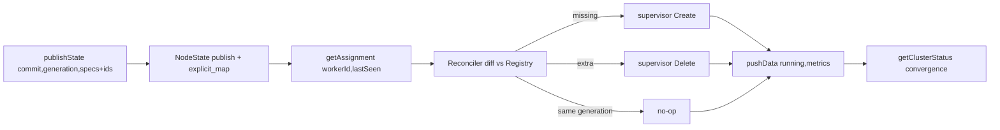

# Architecture

## Control plane pull loop (current state)
- Control plane owns desired state in memory (`control_plane/src/node.rs`
  `NodeState` over `registry.rs` + `store.rs`): generations with commit,
  intent hash, and explicit per-worker assignments carrying opaque spec bytes.
- `Master` RPC (`control_plane/src/server.rs`) is thin translation onto the
  node channel: `publishState` maps `id`/`targetWorker`/bytes,
  `getAssignment` rebuilds spec lists, `pushData` merges heartbeats,
  `getClusterStatus`/`getWorker` serve read views.
- Worker polls `getAssignment` (`worker/src/pull.rs`), reconciles desired
  keys against its registry into supervisor `Create`/`Delete`, and pushes
  `pushData` heartbeats (`worker/src/heartbeat.rs`) tracking the last applied
  generation in a shared cell.
- Inventory is Nix-declared on both sides (`cluster.vms`, CP `workers` list,
  worker `worker_id`); heartbeats add dynamic liveness. No persistence, no
  worker↔master auth (private net assumption).



## Worker process boundaries (current state)
- Existing worker RPC server remains in `worker/src/server.rs`.
- Proxy runtime core + authn/authz gate exist in `worker/src/proxy/core.rs`, and public HTTPS listener serving + TLS wiring is implemented in `worker/src/proxy/tls.rs`.
- Proxy uses subdomain-based routing (`Host: <vm-id>.<base_domain>`) with both `Authorization: Bearer <jwt>` header and `Cookie: pcr_session=<jwt>` cookie auth, plus a bootstrap endpoint at `GET /__pcr/auth?token=<jwt>`.
- Proxy runtime applies optional upstream request timeout from config and emits request outcome logs for auth and upstream diagnostics.

```mermaid
flowchart LR
  Req[HTTPS request <vm-id>.<base_domain>/path] --> TLS[tokio-rustls TLS termination]
  TLS --> Parse[extract_vm_proxy_route from Host header]
  Parse --> Auth[authorize_vm_access]
  Auth -->|bearer header| Bearer{valid JWT?}
  Auth -->|pcr_session cookie| Cookie{valid JWT?}
  Bearer -->|no| U401[401 Unauthorized]
  Cookie -->|no| U401
  Bearer -->|yes, forbidden| F403[403 Forbidden]
  Cookie -->|yes, forbidden| F403
  Bearer -->|yes, authorized| Lookup[lookup_vm_ip via Registry<Reader>]
  Cookie -->|yes, authorized| Lookup
  Parse -->|invalid/unknown vm| N404[404 Not Found]
  Lookup --> URI[build_upstream_uri http://{vm_ip}:4096/path]
  URI --> Dispatch[hyper Client request]
  Dispatch --> Timeout{request timeout configured?}
  Timeout -->|yes + elapsed| T504[504 gateway timeout]
  Timeout -->|no or in-time| Stream[response passthrough body stream]
  Dispatch -->|upstream transport/build failure| G502[502 Bad Gateway]

  subgraph auth_endpoints["Auth endpoints"]
    Bootstrap["GET /__pcr/auth?token=<jwt>&next=<path>"] -->|sets cookie + redirects| Redirect[302 to <next>]
    Logout["POST /__pcr/logout"] -->|clears cookie| Done[200 OK]
  end
```

## Notes
- `worker/src/proxy/interfaces.rs` was removed — contracts are now expressed directly in `worker/src/proxy/core.rs`.
- Proxy auth supports two entry points: `Authorization: Bearer` (for SDKs/curl) and cookie-based (for browser after `/__pcr/auth` bootstrap). `auth_result` log field distinguishes `"bearer"` vs `"cookie"`.
- Worker runtime starts RPC listener (`worker/src/server.rs`), proxy HTTPS listener (`worker/src/proxy/tls.rs`), supervisor loop, assignment poll loop (`worker/src/pull.rs`), and heartbeat reporter (`worker/src/heartbeat.rs`) concurrently on the same process-local Tokio runtime.
- Dev tooling (`nix run .#worker-curl`) uses `--resolve` to map subdomains to localhost; dev TLS cert is `*.worker.local` with SAN.
- Upstream port is hardcoded to 4096 (OpenCode `serve` default), matching the VM image configuration.
