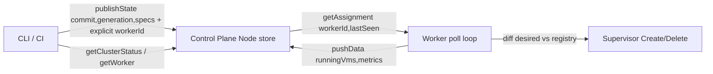

# Plan: control-plane-pull-assignments

## 1) Change summary
Implement pull-based task assignment between control plane and workers for explicit create/delete, with a transport abstraction that allows a push implementation later without refactor.

- Control plane (CP) stores desired generations and per-worker assignments in memory, serves `Master.getAssignment` (workers poll) and ingests `Master.pushData` heartbeats, accepts desired state via `Master.publishState`, and serves read-only `getClusterStatus` / `getWorker` views. CP never dials workers in v1.
- Worker gains a poll + reconcile loop: poll `getAssignment(workerId, lastSeenGeneration)`, diff desired vs local registry, drive existing `Supervisor` via `Command::Create/Delete`, and report `pushData` heartbeats from `read`/`listVms` data. Worker config gains `worker_id`, `master_addr`, poll/heartbeat intervals (nix `worker.nix` already emits `master_addr`; Rust currently ignores it — wire it).
- Worker inventory is deterministic + Nix-configured (`cluster.vms` with `role`, `deployment.addr`, labels) combined with dynamic liveness (last heartbeat, observed generation, health). No ad-hoc worker addresses.
- Transport abstraction: `AssignmentSource` / `WorkerRegistry` / `AssignmentStore` traits in CP plus `PullClient` / `Reconciler` traits in worker, so a future `PushRpc` transport can replace the poll loop without touching scheduler/Node/supervisor logic.
- v1 placement is explicit only: caller specifies target `workerId`; no automatic scheduler. Existing empty `control_plane/src/scheduler.rs::Scheduler` becomes a pure explicit-map function; label/resource-aware scheduling is a later plan.

## 2) Success criteria
- `publishState` stores a new generation and explicit per-worker assignment; `getAssignment(workerId)` returns only that worker's slice with current generation; unknown worker gets empty assignment, not an error.
- Worker poll loop with no changes to Cloud Hypervisor execution or proxy behavior: new desired VM appears via `listVms` after poll; removed VM disappears after poll; no-op when generation unchanged (no spurious restarts).
- `pushData` heartbeats update CP observed state; `getClusterStatus` reports active generation/commit, per-worker health/generation, convergence signal; `getWorker(workerId)` returns last-known worker status or clear not-found.
- Declared workers come from Nix config (`cluster.vms` / control-plane workers list); worker `worker_id` + `master_addr` come from Nix worker config; startup fails fast on missing/duplicate worker ids or missing master addr.
- Transport boundary is trait-based: CP `Server` talks to `Node` via channel only; worker poller talks to `Master` via `PullClient` trait; a push client could implement the same `assign` path later. No direct CP->worker TCP in v1 code.
- `cargo test -p control_plane`, `cargo test -p worker`, `cargo clippy -p control_plane -p worker --all-targets -- -D warnings`, `cargo fmt --all -- --check` pass; no proxy/RPC regressions.

## 3) Constraints and non-goals
### Constraints
- Pull only for v1: CP never dials `Worker.createVm/deleteVm`. Keep `worker/src/server.rs` RPC intact for debugging/CLI but CP does not use it.
- Explicit placement only: no bin-packing, no label selectors, no resource fit in v1. `Scheduler` is a pure `explicit_map(desired, inventory) -> per_worker` function.
- In-memory CP store only: restart loses generations/assignments; workers re-pull on reconnect. No SQLite/Postgres in this plan.
- Keep `BackendConfig` generics (`Master<T>`, `Worker<F::BackendConfig>`) — no CH-specific types in CP.
- Follow existing patterns: fail-fast startup config validation (`worker/src/config.rs` style), channel + `Node`/`Supervisor` separation, structured tracing fields.
- Backoff + timeouts on worker poll/heartbeat; no busy loops; preserve SSE/proxy behavior untouched.

### Non-goals
- No push transport implementation (deferred; abstraction only).
- No automatic scheduling, rebalancing, or migration.
- No pause/resume/snapshot/backup delegation via CP (worker RPC keeps them; CP does not proxy them in v1).
- No mTLS/auth between worker<->master; no ACME; no JWT changes (proxy JWT untouched).
- No persistent CP journal/snapshot, no HA leader election (`peers_addr` stays dormant), no binary-cache/`nix copy` realization on workers.
- No CLI command changes in this plan (CLI can call `publishState`/`getClusterStatus` via existing generated clients; new CLI UX is separate).

## 4) Task stack (`T01..T08`)
- [x] T01: `Define pull transport + registry boundaries` (status:done)
  - Task ID: T01
  - Goal: Introduce trait boundaries that make pull the default but push replaceable: CP `WorkerRegistry` (declared + observed), `AssignmentStore` (generations + per-worker assignments + explicit target contract), `AssignmentSource` transport interface; document that `PushRpc` can implement the same interface later.
  - Boundaries (in/out of scope): In - new `control_plane/src/registry.rs` + `store.rs` (or equivalent) traits/types, `NodeEvent` variants as type stubs, explicit-target identity proposal (targetWorkerId + vm identity within existing `Assignment`/`VmSpec` or minimal schema-extension note, no breakage). Out - any RPC wiring, Node logic, worker code, config changes.
  - Done when: Traits compile with a fake in-memory impl in tests; explicit-target contract documented in code comments; no behavior change to existing stubs.
  - Verification notes (commands or checks): `cargo check -p control_plane`; `cargo test -p control_plane registry` (new boundary tests only).
  - Status: done
  - Completed: 2026-10-10
  - Files changed: `control_plane/src/registry.rs` (new), `control_plane/src/store.rs` (new), `control_plane/src/lib.rs`, `control_plane/src/dto.rs`, `control_plane/src/node.rs`, `control_plane/src/server.rs` (1-line lint fix only)
  - Evidence: `cargo check -p control_plane` (pass), `cargo test -p control_plane` (9 passed), `cargo clippy -p control_plane --all-targets` (no errors; dead_code warnings only), `cargo fmt --check -p control_plane` (pass)
  - Notes: Boundary-only, no behavior change; NodeEvent stubs use `todo!()` arms matching existing Apply behavior. Strict `-D warnings` clippy still reports dead_code (pre-existing stubs + new boundary types unused until T03 wires Node); full strict gate lands in T08 per plan. Also fixed two pre-existing pedantic lints on touched lines: `node.rs` malformed `///!` doc comment, `server.rs` `Default::default()` -> `ReaderOptions::default()` (zero behavior change).

- [x] T02: `Add deterministic Nix-configured worker inventory` (status:done)
  - Task ID: T02
  - Goal: Extend control-plane config with declared workers (`id`, optional addr/labels) sourced from Nix, with fail-fast validation (missing/duplicate ids rejected at startup).
  - Boundaries (in/out of scope): In - `control_plane` config struct + parsing/validation, `nix/modules/control-plane.nix` workers option (derive from `cluster.vms` where `role=worker`, fallback to explicit addrs), `nix/lib` helper if needed. Out - Node/RPC behavior, worker changes.
  - Done when: Sample JSON with workers parses; duplicate/empty id fails startup with explicit error; `nix eval` shows workers flowing into generated CP config.
  - Verification notes (commands or checks): `cargo test -p control_plane config`; `nix eval` / `grep workers nix/modules/control-plane.nix` render check.
  - Status: done
  - Completed: 2026-10-10
  - Files changed: `control_plane/src/config.rs` (new), `control_plane/src/main.rs`, `control_plane/src/lib.rs` (`pub mod config/registry`), `control_plane/Cargo.toml` (+serde/serde_json), `Cargo.lock` (+2 dep edges), `nix/modules/control-plane.nix` (`workers`/`workersAddr` options, `derivedWorkers`, assertion)
  - Evidence: `cargo test -p control_plane` (14 passed: 9 T01 + 5 config), `cargo clippy -p control_plane --all-targets` (0 errors), `cargo fmt --check` (pass), `nix-instantiate --parse` (pass), `nix eval` render harness emits `workers:[{id,addr,labels}]` matching Rust field names, live binary proof: duplicate-id config exits 1 with `worker id is declared more than once: w1`, valid 2-worker config boots and serves (timeout-killed after 3s, exit 124)
  - Notes: Additive `workers` key (default empty) so old JSON without it still parses; unknown `role` envelope tolerated both directions. `WorkerEntry::into_declared` reuses T01 `WorkerId` validation; duplicate detection in both `validate()` (startup message) and `declared_workers()` (registry error). Fixed one new pedantic lint (`map().unwrap_or_else()` -> let-else in `main.rs`). `Node` seeding deferred to T03; `procurator`-bin service-routing mismatch unchanged (flagged for T07).

- [x] T03: `Implement Node in-memory publish/assignment/heartbeat store` (status:done)
  - Task ID: T03
  - Goal: Implement `Node::run` state machine over channel: `publishState` validates + bumps generation + runs explicit-map scheduler into per-worker assignments; `getAssignment` returns filtered slice + generation; `pushData` updates observed runningVms/metrics/health; status queries read consistent snapshot.
  - Boundaries (in/out of scope): In - `dto.rs` message/reply types, `node.rs` logic, `scheduler.rs` explicit-map pure function, unit tests for generation bump, explicit routing, unknown-worker empty assignment, heartbeat merge, convergence computation. Out - Cap'n Proto translation (T04), worker code, persistence.
  - Done when: In-memory roundtrip works: publish(g1, vmA->w1) -> getAssignment(w1)=[vmA], getAssignment(w2)=[], pushData(w1) reflected in status snapshot.
  - Verification notes (commands or checks): `cargo test -p control_plane node scheduler store`.
  - Status: done
  - Completed: 2026-10-10
  - Files changed: `control_plane/src/dto.rs` (domain-typed events, `NodeReply`/`NodeError`/`RequestError`, `NodeMessenger::request`; legacy `Apply` removed), `control_plane/src/node.rs` (pure `NodeState` + always-reply loop), `control_plane/src/scheduler.rs` (`explicit_map` + `ScheduleError`), `control_plane/src/lib.rs` + `control_plane/src/main.rs` (constructor threading of T02 inventory into `Node`)
  - Evidence: `cargo test -p control_plane -- node scheduler store` (14 passed) + full `cargo test -p control_plane` (24 passed: 14 prior + 10 new), `cargo clippy -p control_plane --all-targets` (0 errors), `cargo fmt --check` (pass), live binary smoke: 2-worker fixture boots and serves (timeout-killed, exit 124)
  - Notes: Validation semantics — reject empty commit, `generation <= active` (`StaleGeneration`), undeclared targets (`Schedule(UnknownWorker`); unknown-worker polls stay empty-slice (never errors); convergence = observed-generation == active + order-insensitive running==desired match, percent over declared (100% when none). Fixed two pedantic lints (`collapsible_if` let-chain, pre-existing `node_channel` field renamed to `receiver`). `NodeMessenger::request` returns `Result<NodeResult, RequestError>` so T04 can map inner rejections to Cap'n Proto errors distinctly from transport loss. Generations start at 1 (0 is never newer per store poll semantics — documented in `view_for`).

- [x] T04: `Wire Master RPC handlers to Node (narrowed: schema frozen)` (status:done)
  - Task ID: T04
  - Goal: Replace TODO stubs in `control_plane/src/server.rs` with delegation to `NodeMessenger` channel + Cap'n Proto result mapping. NARROWED per review decision (schema frozen): generation/heartbeat/status plumbing only — `publishState` maps commit/generation/intent and rejects non-empty `vmSpecs` loudly; `getAssignment` echoes generation with empty spec list; `getWorker` resolves through a new swappable `WorkerDirectory` seam (unavailable in pull-mode v1).
  - Boundaries (in/out of scope): In - RPC param extraction, channel send + oneshot await, error mapping, `getWorker` via `WorkerDirectory` (`NoWorkerDirectory` default + `with_directory` injection), in-process loopback roundtrip test. Out - Node logic changes, schema changes, worker client code, spec payload fidelity (deferred to T09).
  - Done when: In-process Master client->server roundtrip passes: publish(empty) -> getAssignment(generation echo) -> pushData -> getClusterStatus(convergence) -> getWorker(errors: unknown vs pull-mode); previous stub strings (`not implemented`) gone.
  - Verification notes (commands or checks): `cargo test -p control_plane server` (new RPC roundtrip tests); `cargo clippy -p control_plane --all-targets`.
  - Status: done
  - Completed: 2026-10-12
  - Files changed: `control_plane/src/server.rs` (5 handlers + loopback tests), `control_plane/src/directory.rs` (new: `WorkerDirectory` trait + `NoWorkerDirectory`), `control_plane/src/lib.rs` (`pub mod directory`), `control_plane/src/dto.rs` (`RequestError: Copy`)
  - Evidence: `cargo test -p control_plane` (27 passed: 24 prior + directory unit + 2 RPC roundtrips), `cargo clippy -p control_plane --all-targets` (0 errors), `cargo fmt --check` (pass)
  - Notes: Review found the plan assumed `publishState` carries vm identity/target — code truth says `VmSpec{spec}` has neither and Node keeps keys only, so faithful payload roundtrip needs schema + Node payload work (deferred to proposed T09; user chose freeze-schema-narrow-T04). Narrowed semantics, all documented in code: non-empty `vmSpecs` → explicit err (no silent drops); `healthy` = true-on-receipt (liveness only); wire metrics debug-logged, zero-filled downstream; `ClusterStatus.vms` empty (Node tracks keys, not hashes/state); content errors → `Result.err` union, framing/transport loss → `Promise::err`. `WorkerDirectory` is deliberately non-generic (generated `get_worker_results` setter is fixed to `Client<any_pointer>`; capabilities untyped on wire so erasure is sound) and `Send`/`Sync`-free (capability clients are thread-local, matching the `spawn_local` loop). Fixed lints: `Results::get()` infallible (only `get_result()` returns `Result`), `master::Server` impl needs `+ 'static` for `from_future` (as worker gets via `Factory: 'static`), `explicit_iter_loop`, `needless_pass_by_value` (`RequestError: Copy`), one scoped `arc_with_non_send_sync` allow in test.

- [x] T05: `Add worker pull + reconcile loop` (status:done)
  - Task ID: T05
  - Goal: Add worker `PullClient` trait + poll task (`getAssignment` with `lastSeenGeneration`, timeout + backoff) and `Reconciler` that diffs desired vs `Registry<Reader>` and emits `Command::Create` (via `Factory::create_vm`) / `Command::Delete` to existing supervisor channel; no-op on unchanged generation.
  - Boundaries (in/out of scope): In - `worker/src/pull.rs` (or `sync/`) + `worker/src/config.rs` additions (`worker_id`, `master_addr`, poll interval), `lib.rs` task wiring alongside RPC/supervisor/proxy. Out - heartbeat reporting (T06), CP changes, CH execution changes.
  - Done when: Mock Master returns g1=[vmA], worker creates via supervisor; g2=[] deletes; same generation polls cause no channel sends; poll backoff on Master error.
  - Verification notes (commands or checks): `cargo test -p worker pull reconciler`; `cargo check -p worker`.
  - Status: done
  - Completed: 2026-10-12
  - Files changed: `worker/src/pull.rs` (new: `PullClient`/`RpcPullClient`/`Reconciler`/`backoff_delay`/`poll_loop`/`run_poll_loop`/`PollConfig` + tests), `worker/src/test_support.rs` (new: fake backend + temp DBs), `worker/src/config.rs` (required `worker_id`/`master_addr`, defaulted `poll_interval_millis` + tests), `worker/src/lib.rs` (params + `spawn_local` poll task + `select!` branch), `worker/src/vmm/supervisor.rs` (`CreateCommand::into_parts` accessor), `worker/src/vmm/mod.rs` (test-gated `Writer` re-export), `nix/lib/worker.nix` (`workerId`/`pollIntervalMillis` defaults + passthrough)
  - Evidence: `cargo test -p worker` (51 passed: 38 prior + 13 new — 5 config, 8 pull incl. scripted loop + loopback RPC), `cargo clippy -p worker --all-targets` (0 errors), `cargo fmt --check` (pass), `nix eval` renders `worker_id`/`poll_interval_millis` matching Rust field names, loop test stable 3× consecutive runs
  - Notes: Review ruling B applied — `worker_id` hard-required + validated (fail-fast), `master_addr` required (all generated configs already emit it), poll default 2000ms; dev stays green via nix-lib defaults, `service.nix` options stay T07. Design: poll owns the RPC message, specs cross as serialized bytes and materialize iteration-locally (no reader lifetimes escape); index-derived keys interim inside the wire bridge only (reconciler key-opaque, T09 replaces derivation); creates re-key factory-uuid commands via `into_parts`; `Send`-free thread-local client matching the `spawn_local` loop; `F::BackendConfig: Unpin` bound where `send()` needs it; `PollConfig` struct keeps `run()` at 6 args and takes T06's heartbeat interval later. Lints fixed along the way: `Results::get()` infallible knowledge reused, `+ 'static`/`Unpin` placement, `explicit_iter_loop`, `await_holding_lock` (clone-before-await in test), `arc_with_non_send_sync` avoided by test-local design, `too_many_arguments` (PollConfig), `manual_async_fn` vs E0195 resolved per-site (explicit form only where GAT lifetimes demand it). Debugging note: an early channel-observation form of the loop test misled (consumed-message accounting); restructured to a mini-supervisor applier closing the loop — deterministic create→apply→delete, passes repeatedly.

- [x] T06: `Add worker heartbeat reporter` (status:done)
  - Task ID: T06
  - Goal: Implement periodic `pushData(workerId, observedGeneration, runningVms, metrics)` built from `Registry<Reader>` (`listVms`/`read` shaping: id/status/uptime/metrics) + resource metrics, with interval config and failure backoff.
  - Boundaries (in/out of scope): In - heartbeat task, `RunningVm`/`WorkerMetrics` mapping, `observedGeneration` tracking from last applied assignment. Out - poll logic changes (T05), CP changes.
  - Done when: Heartbeat payload matches registry contents; unhealthy VM reflected; missed Master does not crash poller; intervals configurable.
  - Verification notes (commands or checks): `cargo test -p worker heartbeat`; `cargo clippy -p worker --all-targets -- -D warnings`.
  - Status: done
  - Completed: 2026-10-12
  - Files changed: `worker/src/heartbeat.rs` (new: report builder, `PushClient`, loops + tests), `worker/src/pull.rs` (`AppliedGeneration` cell, `PushClient`-for-`RpcPullClient` wire impl, `PollConfig.heartbeat_interval`, poll threading, T05 test updates), `worker/src/lib.rs` (shared cell, heartbeat task + `select!` branch), `worker/src/config.rs` (`heartbeat_interval_millis` default 5000 + tests), `worker/src/test_support.rs` (`FakeHandle::failing`), `nix/lib/worker.nix` (default + passthrough)
  - Evidence: `cargo test -p worker` (56 passed: 51 prior + 5 heartbeat), `cargo test -p worker heartbeat` (5 passed, stable repeats), `cargo clippy -p worker --all-targets` (0 errors), `cargo fmt --check` (pass), zero build warnings, `nix eval` renders `heartbeat_interval_millis: 5000` matching the Rust field
  - Notes: `applied` moved from poll-local into shared `AppliedGeneration` (poison-tolerant lock, no await under guard) — poll logic otherwise untouched. Mapping mirrors `listVms`/`read` exactly (running/failed via `health()`, sorted ids, `contentHash ""`/uptimes `0`/zeroed metrics like `read()`); `healthy` = conjunction; generation 0 until first poll (liveness-first). Separate redialing heartbeat connection (documented; multiplex later). `Rejected` backoffs in place, `Transport` returns for redial, dial failures back off — nothing propagates, poller independent. `PushClient` deliberately thread-local like `PullClient` (no `Send`); `Send`-free `WorkerDirectory`-style seam consistent with T04. Lints: `Handle` import for `health()`, `explicit_iter_loop` on wire lists, `+ 'static`/`Unpin` already in place from T05.

- [x] T07: `Wire Nix master/worker addrs + explicit e2e` (status:done)
  - Task ID: T07
  - Goal: Fix config drift (`nix/lib/worker.nix` emits `master_addr` but Rust ignores it): plumb `workerId`/`masterAddr`/intervals through `nix/modules/worker/service.nix` into worker JSON; add minimal 1-CP + 1-worker dev/cluster example; demonstrate explicit create+delete end-to-end via pull.
  - Boundaries (in/out of scope): In - nix plumbing, worker `Config::from_file` compat, e2e harness/test (publish explicit for w1 -> worker `listVms` shows VM -> publish removal -> disappears). Out - scheduler smarts, CLI UX, persistence.
  - Done when: Fresh worker with only `master_addr`+`worker_id` boots, polls, reconciles one VM create + delete without manual worker RPC; nix example builds/renders.
  - Verification notes (commands or checks): `cargo test -p worker -p control_plane`; e2e script/test log showing poll->create->heartbeat->status convergence.
  - Status: done
  - Completed: 2026-10-12
  - Files changed: `nix/modules/worker/service.nix` (`workerId` + non-empty assertion, `pollIntervalMillis`, `heartbeatIntervalMillis` + passthrough), `nix/tests/worker-service-fast.nix` (new: module render + assertion tests), `worker/src/e2e.rs` (new: cross-crate pull e2e), `worker/Cargo.toml` (dev-dep on `control_plane`), `worker/src/config.rs` (ch-typed nix-shape parse test), `Cargo.lock` (+1 dev-dep edge)
  - Evidence: `cargo test -p control_plane -p worker` (29 + 58 passed, incl. new e2e + ch-compat), `cargo clippy` (0 errors), `cargo fmt --check` (pass), `nix eval --json -f nix/tests/worker-service-fast.nix` → `true` (explicit options reach JSON, cluster-ref resolves, both assertions fail fast), `nix-instantiate --parse` (pass), e2e stable 3× runs
  - Notes: Review found T07-as-written blocked (CP rejects specs pre-T09); user chose T09-first reorder, so T07 runs now with real payloads. e2e drives real `control_plane::main` on a dedicated thread (no `LocalSet` nesting) + real worker poll/reconcile/heartbeat pieces over loopback RPC with fake execution: publish(vm-e2e→w1) → fetch/reconcile/Create → heartbeat → status (1, commit-1, 100%, 1 worker) → republish empty → fetch/reconcile/Delete → heartbeat → status (2, commit-2, 100%). Deterministic piece-driving (loops covered in T05/T06); only CP-ready dial retries. `workerId` default `""` + eval assertion (explicit over magic, mirrors `master` pattern); `service.nix` is the last nix surface (dev app already flows via lib defaults).

- [x] T08: `Validation, cleanup, and context sync` (status:done)
  - Task ID: T08
  - Goal: Run full validation, remove temporary scaffolding, and sync `context/` current-state docs with final pull design and config contracts.
  - Boundaries (in/out of scope): In - `cargo test -p control_plane -p worker`, clippy strict, fmt, removal of temp debug code, updates to `context/architecture.md`, `context/overview.md`, `context/glossary.md`, new `context/control-plane/` domain file if needed, `context-map.md` references. Out - new feature work.
  - Done when: All checks pass; no temp scaffolding remains; context reflects pull flow, explicit placement, Nix worker inventory, and transport abstraction for future push.
  - Verification notes (commands or checks): `cargo test -p control_plane -p worker`; `cargo clippy -p control_plane -p worker --all-targets -- -D warnings`; `cargo fmt --all -- --check`; context sync review.
  - Status: done
  - Completed: 2026-10-12
  - Files changed: `control_plane/src/{dto,server,store}.rs` (7 scoped `allow(dead_code)` with rationale), `worker/src/e2e.rs` (removed duplicated line), `context/{overview,architecture,glossary,context-map}.md`, `context/{control-plane/node-state,worker/pull-reconcile}.md` (final pass)
  - Evidence: `cargo test -p control_plane -p worker` (29 + 58 passed), `cargo clippy -p control_plane -p worker --all-targets -- -D warnings` (pass), `cargo fmt --all -- --check` (pass), `cargo check --workspace` (pass; pre-existing warnings in untouched `autonix`/`cli` reported, not touched), temp fixtures removed, marker sweep clean
  - Notes: Strict gate needed per-item allows (test-covered read APIs + future push/CLI seams — removing them would destroy approved abstractions; `AssignmentSource`/`with_directory` are deliberate seams, not scaffolding). Strict run also caught one real duplicated line in e2e test helper (removed). Pre-existing TODOs and untouched-crate warnings left alone. `patterns.md` untouched (not in T08 file list; its stale proxy section predates this plan).

- [x] T09: `Spec payload roundtrip: identity, targets, Node payload retention` (status:done)
  - Task ID: T09
  - Goal: Make `publishState`/`getAssignment` carry real VM specs end-to-end. APPROVED SCOPE (review decision: T09 runs before T07): additive `id` + `targetWorker` on `Common.VmSpec`; Node retains opaque spec bytes per (worker, key); `getAssignment` rebuilds spec lists; worker pull bridge derives keys from wire ids (blank ids skipped with warn); `getWorker` stays capability-route (documented, no change).
  - Boundaries (in/out of scope): In - `.capnp` additive fields + regen, Node payload store + wire bridge (`VmSpec` <-> `VmKey`) on both CP and worker sides (worker: fetch mapping only — reconciler/heartbeat untouched, they are key-opaque by design), translation updates in `server.rs`, roundtrip + mapping + compat tests, context docs. Out - push transport, scheduler smarts or semantic changes, CLI UX.
  - Done when: Roundtrip publishes 2 specs for explicit workers and polls back semantically equal specs per worker (id/target/spec-fields; framing bytes may differ); unknown-target and blank-id publishes fail loudly; blank-id wire specs are skipped with warn on the worker; `getWorker` documented as capability-route; context docs updated.
  - Verification notes (commands or checks): `cargo test -p control_plane server`; `cargo test -p worker pull`; `cargo clippy`; default-field read check (new reader reads old-shaped data as `""`).
  - Status: done
  - Completed: 2026-10-12
  - Files changed: `commands/schema/common.capnp` (`id @1` + `targetWorker @2`), `control_plane/src/store.rs` (`AssignedVm`, payload-carrying slices, retention + prune test), `control_plane/src/scheduler.rs` (grouped entries, payloads preserved), `control_plane/src/node.rs` (flatten + `keys()` switches), `control_plane/src/server.rs` (publish mapping + rebuild + ch-backend roundtrip tests), `worker/src/pull.rs` (id-derived keys, blank skip, stub ids), `context/control-plane/node-state.md` + `context/worker/pull-reconcile.md` (payload/identity docs)
  - Evidence: `cargo test -p control_plane` (29 passed: +payload retention + default-compat + rewritten ch roundtrip incl. republish-move, stale reject, blank/unknown-target loud failures), `cargo test -p worker` (56 passed incl. wire-id loopback with blank-skip), `cargo clippy -p control_plane -p worker --all-targets` (0 errors), `cargo fmt --check` (pass), suites re-run green
  - Notes: Review verified in capnp source that `Owned` requires `Reader: SetterInput<Self>`, but the response list is branded `any_pointer` by generated code regardless of `T` — so the backend crosses via `any_pointer::Builder::set_as` server-side and brand reinterpretation (identical layout) worker-side; both documented. Semantic (not byte) equality asserted since framing may normalize. Same-key-different-target is last-write-wins, no scheduler change. `getWorker` unchanged by decision (capability route documented). One parallel-load flake observed in untouched `ch` disk-copy test (passes solo + reruns); unrelated. Lints: `explicit_iter_loop` (3 sites), scoped `too_many_lines` allow on the grown roundtrip test (documented), removed now-unused `DesiredEntry::spec()` accessor.

## 5) Open questions
- RESOLVED (T04 review): explicit create/delete stays pull-internal with no new imperative RPCs, but `publishState` carries no vm identity/target on the wire — decided to freeze the schema, narrow T04 to generation/heartbeat/status plumbing, and defer payload fidelity to proposed T09 (awaiting scope confirmation before implementation).
- RESOLVED (T07 review): user chose T09-first reorder — T09 runs now with the approved scope above (schema + CP payload + worker bridge, `getWorker` documented as-is), then T07 as written.
- Poll/heartbeat defaults: propose poll 2–5s, heartbeat 5–10s, configurable via `healthTickMillis`-style millis options; confirm during T05/T06.
- CP restart durability: v1 in-memory only accepted? If generation persistence is required, needs follow-up plan (SQLite journal).
- Worker->master auth: none in v1 (private net assumption). If exposed, needs mTLS/token follow-up.

## Validation Report (T08)

### Commands run
- `cargo test -p control_plane -p worker` -> exit 0
  - control_plane: 29 passed, 0 failed (registry/store/scheduler/node/dto/config/directory/server incl. ch-backend roundtrip)
  - worker: 58 passed, 0 failed, 2 ignored (pre-existing CAP_NET_ADMIN TAP tests)
- `cargo clippy -p control_plane -p worker --all-targets -- -D warnings` -> exit 0 (no errors, no warnings)
- `cargo fmt --all -- --check` -> exit 0
- `cargo check --workspace` -> exit 0 (schema change builds everywhere; warnings in untouched `autonix`/`cli` are pre-existing)
- `nix eval --json -f ./nix/tests/worker-service-fast.nix` -> `true` (new)
- `nix eval --json -f ./nix/tests/vm-spec-fast.nix` -> `true` (unaffected)
- `nix eval --json -f ./nix/tests/cluster-fast.nix` -> fails (PRE-EXISTING: imports `nix/lib/cluster`, `nix/lib/profile` which do not exist at HEAD; untouched by this plan)
- `nix eval --json -f ./nix/tests/profile-fast.nix` -> fails (same pre-existing cause)

### Temporary scaffolding cleanup
- Removed: `context/tmp/cp-valid.json`, `context/tmp/cp-duplicate.json` (T02 startup-proof fixtures, gitignored scraps)
- Marker sweep (`todo!`, `unimplemented!`, `eprintln!`, `dbg!`, `FIXME`, `HACK`) over all touched files: clean (test assertion panics only)
- Pre-existing `TODO` comments and untouched-crate warnings left alone

### Success-criteria verification (plan section 2)
- [x] publish stores explicit per-worker assignment; unknown worker gets empty slice — T03 unit tests + T09 ch roundtrip (per-worker slices, ghost empty)
- [x] Worker poll loop creates/deletes/no-ops without CH changes — T05 scripted + loopback tests; T07 cross-crate e2e (Create then Delete through real CP)
- [x] pushData updates observed state; status/convergence served; getWorker clear errors — T03/T04/T06 tests; T07 e2e asserts 100% convergence twice
- [x] Nix-declared inventory + fail-fast worker identity — T02 binary proof (exit 1 + message), T05/T06/T07 nix eval renders, service.nix assertions eval-tested
- [x] Trait boundaries, CP never dials workers — code truth: only `WorkerDirectory` (always-unavailable in v1) names worker clients; no `TcpStream::connect` to workers anywhere in `control_plane`
- [x] Full checks pass, no regressions — this report; proxy behavior untouched (no proxy files changed by this plan)

### Residual risks
- CP state is in-memory only (restart loses generations; workers re-pull) — accepted v1 per plan; SQLite journal is follow-up work if needed.
- No worker<->master auth (private-net assumption) — mTLS/token is follow-up work if exposed.
- `ClusterStatus.vms` stays empty and metrics zero-filled until per-VM telemetry lands.
- Two workers polling one id, or same key on two workers (last-write-wins), are operator errors caught only by loud failures, not prevention.
