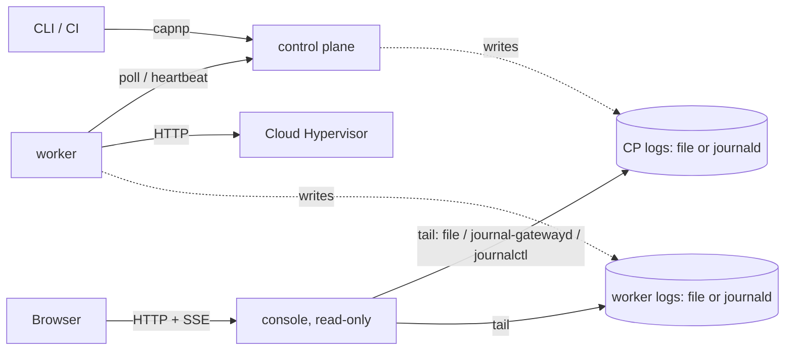

# Plan: control-plane-web-console

## Status (2026-11-15)
- **Done:** T01–T14 and T16. Evidence:
  - `cargo test` passes: `control_plane` 29, `worker` 60, `console` 12.
  - `cargo clippy -D warnings` is clean for all three crates.
  - Pure-eval checks pass: `console-fast`, `control-plane-fast`, `worker-service-fast`, and the full `services-system-eval` (which also needed a cache declared; it was already broken by the cache rewrite).
  - Manual end-to-end runs:
    - real control plane + worker logging to files, plus a synthetic worker log, through the console with `file` sources;
    - the real `systemd-journal-gatewayd`, including a disconnect and a cursor resume;
    - Chromium driven by puppeteer: the map pulses, the feeds update, all pages render with no JS errors, and repeated reloads don't stall.
- **Deferred:** T15 (inside-VM data), pending discussion.
- **Deviations from the plan:**
  - The console serves one SSE stream, `/api/stream`, instead of three. Three per page exhausted the browser's six-connection limit after two reloads.
  - Message filtering happens in the client.
  - Worker heartbeat wire metrics stay zeroed. Real metrics only go to the state lines.
  - Cloud Hypervisor message lines use the factory-minted VM id, not the desired key.
  - T16 uses a pure-eval test, following the repo's pattern, rather than a VM test.
  - The `console` package was not built through Nix (naersk). It was only built with cargo.
- **Still open:** the restart-wipe bug described in §6.

## 1) Change summary
A new, **read-only** `console` service: a small web server and UI that shows the cluster live. It builds everything it shows **only by reading and parsing the logs each service already writes**.
- It performs no actions and makes no RPC calls.
- Services don't send logs anywhere, share no telemetry crate, and don't know the console exists. They keep logging with plain `tracing` macros, in JSON, following a documented field convention.

- **Log sources, a config knob per service:**
  - `file`: a `tracing-appender` JSON file. Use it for manual runs where everything is on one machine.
  - `journal_gateway`: `systemd-journal-gatewayd` on each host, pulled over HTTP by the console and filtered by unit. Use it for systemd deployments.
  - `journal_local`: `journalctl -f -o json -u <unit>`, for local systemd runs.
- **The services write three kinds of lines:**
  - **Message lines:** one per RPC, poll, heartbeat or Cloud Hypervisor call, with from, to, method, outcome and latency. They animate the map.
  - **State lines:** written periodically. The control plane writes desired state; the worker writes observed state, with per-VM status, uptime, IP and metrics. They build the machines and VMs on screen.
  - **Change and plain log lines:** these carry `worker`/`vm`/`unit` fields so the detail pages can filter them.
- **Pages:**
  - **Map (main page):** machines containing their VMs, with messages animating on the edges in real time.
  - **Machine page:** its state, VMs, metrics, logs and messages.
  - **Unit page:** VMs grouped by a `unit` field when the logs carry one. Units themselves are a separate plan; until then everything is "ungrouped".
  - **VM page:** status, metrics, logs and messages, plus optional data from inside the VM (T15, pending decision).
  - **Sources page:** the health of each log source.
- **Real-time only.** No history. At startup the console reads back a short **bootstrap window** (default 30 s) so it can rebuild current state from the periodic state lines, then just follows new lines.
- **As simple as possible:** an axum server serving embedded static HTML, CSS and one vanilla JS file, plus a JSON snapshot endpoint and SSE streams. No template engine, no htmx, no bundler, no auth.

## 2) Success criteria
- **Log output:** the control plane and worker each write JSON lines to stdout (journald) or a file, chosen in their config. The lines follow `context/specs/log-events.md`.
- **Sources:** the console follows every configured source (`file`, `journal_gateway`, `journal_local`). It survives file rotation and reconnects to a gateway resuming from the journal cursor, without duplicates.
- **Startup:** after a console start, the map shows the correct machines, VMs and health within one bootstrap window.
- **Map:**
  - Health and VM state update within one state interval.
  - A publish, poll, heartbeat, control plane → worker RPC, or worker → Cloud Hypervisor call animates its edge within about 1 s of being logged. Failures show in red.
  - Unchanged polls are collapsed into edge counters by default.
- **Detail pages:** the machine, unit, VM and sources pages show the data in §1 and update live.
- **No side effects:** the console never writes to or calls any service.
- **Gates:**
  - `cargo test` passes for `control_plane`, `worker` and `console` (unit tests of the console's own logic: sources, model join, health).
  - `cargo clippy --all-targets -- -D warnings` passes for those crates.
  - `cargo fmt --all -- --check` passes.
  - A Nix VM test shows the console reading both journals through the gateway and serving a live message.

## 3) Constraints and non-goals
### Constraints
- **The log is the only interface** between the services and the console. The convention lives in a spec document. No tests assert the JSON shape of service logs; drift shows up as unparsed lines on the Sources page.
- **Plain `tracing` only.** JSON is flattened (`flatten_event(true)`) so convention fields sit at the top level of each line.
- **Project rules** (`.claude/CLAUDE.md`):
  - Keep everything private: private fields, minimal getters, private functions.
  - No `pub(crate)` or `pub(super)`.
  - Avoid needless `clone`/`to_string`/`to_owned`; parse borrowing from the line buffer where possible.
  - No `type` aliases.
  - `mod.rs` files only re-export.
  - Prefer `impl Future`.
  - Don't overuse `Arc`/`Mutex`.
- **Console listener:** binds `127.0.0.1` by default.
- **Log levels:** state and message lines are `info`, so default `RUST_LOG` filters don't hide them (coordinate with `plans/rust-log-env-var.md`).

### Non-goals
- Any action from the console: stop/start, pause, create, delete, or RPC of any kind.
- Message or log history, replay, search, or storage.
- Deployment-unit semantics and the master flake (separate plan). The console only groups by a `unit` field if one appears.
- A raw serial console.
- Auth or TLS on the console, and securing journal-gatewayd. It is simply enabled for now; see §6.
- Services outside the control-plane star (`cache`, `ci_service`, `repohub`, the worker proxy). They can adopt the convention later with just a source entry.

## 4) Task stack (`T01..T16`)

### Phase A — services write the convention
- [ ] T01: `Log-event spec` (status:pending)
  - Goal: Write `context/specs/log-events.md` covering:
    - **Line format:** flattened JSON with `timestamp`, `level`, `target`, fields, and `log.schema=1`.
    - **Message lines:** `log.event="msg"`, `msg.kind` (`publish|poll|heartbeat|status|rpc|vmm`), `msg.from` / `msg.to` (`cp`, `worker:<id>`, `client:<addr>`, `vmm:<vm>`), `msg.method`, `msg.outcome` (`ok|rejected|transport`), `latency_ms`, and optional `worker`, `vm`, `unit`, `generation`, `count`, `unchanged`.
    - **Logging rule:** one line per message, written by the callee when the callee is ours, and by the caller otherwise (Cloud Hypervisor) or on transport failure.
    - **State lines:** `log.event="state"`. The control plane writes `scope="cluster"` (generation, commit, per-worker desired VM keys). The worker writes `scope="worker"` (id, applied generation, per-VM status/uptime/ip/metrics, host metrics). Both are emitted on change and every interval.
    - **Change lines:** `log.event="change"`, for a VM created, deleted or failed, or a worker reconnecting.
    - **Plain lines:** carry `worker`/`vm`/`unit` where known.
    - **One example per line type.**
  - Done when: the spec covers every edge and page in §1.

- [ ] T02: `JSON log output knob` (status:pending)
  - Goal: Give the control plane and worker a `log` config section: `{ format: "json" (default) | "pretty", destination: "stdout" (default) | { file: path, rotation: "never" | "daily" } }`. Files go through `tracing-appender` with a non-blocking writer whose guard is held in `main`. The worker switches from text plus `FmtSpan::CLOSE` to flattened JSON. Nix keeps stdout so journald captures it.
  - Boundaries: in `control_plane/src/main.rs`, `config.rs`, `worker/src/main.rs`, `config.rs`, `nix/lib/worker.nix` defaults.
  - Done when: both binaries write valid JSON lines to stdout or a file per config (checked manually with `jq`).
  - Verification: `cargo test -p control_plane -p worker config`; manual run.

- [ ] T03: `Control plane writes convention lines` (status:pending)
  - Goal:
    - Fix the `TODO` in `Server::serve` with a per-connection bootstrap client carrying `peer_addr`, so lines can say `client:<addr>`.
    - Each `Master` handler writes one message line on completion: `from=worker:<id>` when the params carry one and `client:<addr>` otherwise, plus `latency_ms` and the outcome. `getAssignment` sets `unchanged`.
    - `Node` writes a `scope=cluster` state line on every change and every `state_log_interval_millis` (default 10000), and a change line on each new generation.
  - Boundaries: in `control_plane/src/server.rs`, `node.rs`, `config.rs`.
  - Verification: `cargo test -p control_plane` (existing tests stay green); manual run piped through `jq`.

- [ ] T04: `Worker writes convention lines + real metrics` (status:pending)
  - Goal: The worker writes:
    - message lines for its `Worker` RPC handlers (per-connection peer as in T03);
    - caller-side lines for Cloud Hypervisor API calls (`to=vmm:<vm>`, method, latency);
    - caller-side `transport` lines for failed polls and heartbeats;
    - change lines for reconcile create/delete and VM failures;
    - a `scope=worker` state line per heartbeat.
    
    Metrics are sampled for real: Cloud Hypervisor `vm.counters` for net and disk, `/proc` and cgroup for each VMM process's CPU and RSS, and host CPU, memory and disk. The same values fill the heartbeat `RunningVm.metrics` / `WorkerMetrics`, which are zeroed today.
  - Boundaries: in `worker/src/server.rs`, `ch/client.rs`, a new `metrics.rs`, `pull.rs`, `heartbeat.rs`, `vmm/registry.rs` (start time for uptime), `vmm/supervisor.rs`.
  - Verification: `cargo test -p worker` (existing tests plus a metrics parser test against a fake Cloud Hypervisor API response); manual run.

### Phase B — the console service
- [ ] T05: `console crate + config` (status:pending)
  - Goal: Create a new workspace crate `console` (binary `console`) with a JSON config (Nix-rendered) and fail-fast validation. Config fields:
    - `http_addr` (default `127.0.0.1:8095`);
    - `bootstrap_window_millis` (default 30000);
    - `sources`: a list of `{ name, service: "control_plane" | "worker:<id>", kind }`, where `kind` is one of:
      - `{ file: { path } }`;
      - `{ journal_gateway: { url, unit } }`;
      - `{ journal_local: { unit } }`.
  - Verification: `cargo test -p console config`.

- [ ] T06: `Log sources` (status:pending)
  - Goal: A `LogSource` trait yields raw lines. Implementations:
    - **`FileSource`:** follow with rotation detection (inode change or truncation). At startup it seeks back until timestamps are older than the bootstrap window.
    - **`JournalGatewaySource`:** `GET /entries?follow&_SYSTEMD_UNIT=<unit>` with `Accept: application/json` and `Range: realtime=<now-window>:` on first connect, then `Range: entries=<__CURSOR>` after a reconnect. Each entry's `MESSAGE` field is the service's JSON line. Capped backoff on errors.
    - **`JournalLocalSource`:** `journalctl -f -o json -u <unit> --since=-<window>` as a child process, restarted if it exits.
    
    Each source reports its health: connected, last line age, unparsed count.
  - Boundaries: in `console/src/sources/` (`mod.rs` re-exports only). Tests cover file rotation and gateway resume against an axum stub.
  - Verification: `cargo test -p console sources`.

- [ ] T07: `Parser + live model` (status:pending)
  - Goal: Parse lines into message, state, change and log events; lines that don't match are counted per source. A model actor (single owner) works as follows:
    - It builds machines and VMs from the latest `cluster` and `worker` state lines, joining desired and observed into `running|failed|missing|orphan`.
    - It groups VMs by `unit` when present.
    - Worker health is "a worker state line seen within 3 × heartbeat".
    - It fans out to `broadcast` channels: state diffs, messages, and logs keyed by scope.
    - During bootstrap the model is rebuilt silently; nothing is streamed.
  - Boundaries: in `console/src/parse.rs`, `model.rs`. Unit tests cover the join and health logic.
  - Verification: `cargo test -p console model`.

- [ ] T08: `HTTP API + live streams` (status:pending)
  - Goal: axum routes:
    - `GET /api/model` (snapshot);
    - `GET /api/stream/state` (SSE diffs);
    - `GET /api/stream/messages?worker=&unit=&vm=&kind=`;
    - `GET /api/stream/logs?scope=`;
    - `GET /api/sources`.
    
    Streams are live-only, with `event: lagged` when a subscriber falls behind. Embedded static files (`include_bytes!`) are served under `/` and `/assets/*`.
  - Boundaries: in `console/src/http/`.
  - Verification: `cargo test -p console http`.

### Phase C — pages (static HTML + one vanilla JS file)
- [ ] T09: `UI shell` (status:pending)
  - Goal: Static HTML pages sharing one stylesheet (light and dark) and one `app.js` that handles the SSE connection, reconnects and routing by URL. Nav: Map, Machines, Units, Sources. Pages fetch `/api/model` and then follow the streams.

- [ ] T10: `Map page` (status:pending)
  - Goal: `/` shows:
    - **Topology:** an SVG with the control plane in the centre and machines on a ring. Machine boxes contain VM chips coloured by state (and by unit when present), plus a small "vmm" anchor. External clients are grouped by address.
    - **Message animation:** a pulse runs along `from → to` for each message line, coloured by kind, with errors in red. Edges show msgs/s and the last latency. Unchanged polls collapse into counters unless "show all" is on. Pulses are capped per second, and `prefers-reduced-motion` turns them off.
    - **Messages drawer:** the last 200 messages since the page opened, with filter chips.
    - **Navigation:** clicking a machine or VM opens its page.
    - At phone width the drawer stacks under the map.
  - Done when: manual check with both source modes (file for a manual run, gateway in the Nix VM test): polls tick, a publish animates client → CP → polls → worker → vmm, a VM appears in its machine, and a killed worker turns red. Record screenshots.

- [ ] T11: `Machine pages` (status:pending)
  - Goal: `/machines` and `/machines/:id` show health, last state-line age, generation, host metric sparklines (from page-open onward), a VM table, live worker logs and live messages.

- [ ] T12: `Unit pages` (status:pending)
  - Goal: `/units` and `/units/:unit` show VMs grouped by the `unit` field across machines, with desired vs observed state and live messages. Until units exist, there is one "ungrouped" unit.

- [ ] T13: `VM page` (status:pending)
  - Goal: `/vms/:key` shows:
    - **Overview:** state, worker, unit, IP, uptime, generation.
    - **Metrics:** sparklines.
    - **Logs:** worker-side lines with `vm=<key>`.
    - **Messages.**
    - A slot for the T15 inside-VM data.

- [ ] T14: `Sources page` (status:pending)
  - Goal: `/sources` shows each source's kind, target, connection state, last line age, unparsed count, and the last few unparsed lines, for spotting convention drift.

### Phase D — optional and packaging
- [ ] T15: `Inside-VM data (pending decision)` (status:pending)
  - Goal: Read each VM's own journal so the VM page shows what is happening inside it. The guest image enables journal-gatewayd, and the console opens a gateway source to the VM's IP (taken from worker state lines) only while its page is open. What to show is decided in §5.
  - Boundaries: in `nix/lib/diskVm.nix`, `console/src/sources/`, `model.rs`, `vm.html`.

- [ ] T16: `Nix module, dev run, VM test, docs` (status:pending)
  - Goal:
    - **Console module:** a new `nix/modules/console.nix` that derives `journal_gateway` sources from the cluster config (control-plane host and each worker host).
    - **Hosts:** enable `services.journald.gateway` on the control-plane and worker hosts.
    - **Manual runs:** a dev config where every service logs to a file and the console uses `file` sources.
    - **VM test:** the console reads both journals over the gateway, `/api/model` shows the worker and its VMs, and a poll message arrives on the stream.
    - **Docs:** a `console/README.md`, plus updates to `context/context-map.md` and the glossary (message line, state line).

Ordering:
- T01 comes first.
- T02 → T03/T04.
- The console work T05–T08 can start right after T01, against the spec examples.
- The pages need T08.
- T15 waits for §5.

## 5) Open question
- **What to show from inside each VM (T15).** Candidates, all from the VM's journal:
  - **Failed or restarting systemd units:** the VM is "running" from the worker's view, but is the app actually up?
  - **The deployed service's own logs:** usually the most useful.
  - **Boot health:** boot time ("Startup finished in …"), boot failures, kernel errors.
  - **Resource trouble inside the guest:** OOM kills, disk full.
  - **The running NixOS system path or commit**, to check that the VM really runs what was published.
  - **Network setup:** the IP applied from the kernel command line, DNS.
  - **SSH logins.**
  
  Recommended v1: failed/active units, service logs, and boot health. Alternatively skip T15 and keep the VM page to what the worker logs.

## 6) Risks
- **Convention drift.** Logs are an implicit API with no tests on their shape. Drift shows as unparsed lines on the Sources page. Bump `log.schema` on breaking changes.
- **State only as fresh as the state lines.** The view lags by up to one interval (CP 10 s, worker 5 s). State lines are periodic, not only on change, so a console started at any time recovers within the window.
- **Log volume and journald rate limits.** Polls and heartbeats add about 0.7 lines/s per worker. Raise `RateLimitBurst` for these units in Nix if lines get dropped.
- **Clock skew across hosts.** The live view orders by arrival. Latency comes from each line's own `latency_ms`.
- **Open journal gateways.** journal-gatewayd has no auth: anyone who can reach port 19531 on a host can read its whole journal. This is accepted for now (trusted network) and should be revisited before any exposed deployment.
- **Startup blind spot.** Until the first state lines arrive, the map is partial. The UI shows "warming up" per source.
- **Unrelated bug found, not fixed here.** After a control-plane restart, a worker can delete all its VMs:
  - `InMemoryAssignmentStore::assignment_for` (`control_plane/src/store.rs:313`) answers `last_seen >= active` with an empty VM list;
  - the worker (`worker/src/pull.rs:441`) reconciles whenever the generation number differs.
  
  It is latent while CI generations only increase. It deserves its own small fix plan.
